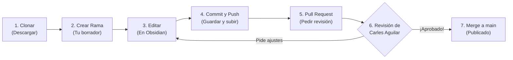

<div align="center">

# 📓 Guía de Colaboración — Vault

**Bienvenido/a al repositorio compartido del Vault.**  
Esta guía está pensada **desde cero** para personas que nunca han usado Git ni GitHub.

[](https://github.com/Challsss/Vault)
[](https://obsidian.md/download)
[](https://desktop.github.com/)

</div>

---

## 🧭 Índice Rápido

1. [¿Qué es esto y cómo funciona?](#-1-qué-es-esto-y-cómo-funciona)
2. [Diccionario de Supervivencia](#-2-diccionario-de-supervivencia)
3. [Las Reglas de Oro](#-3-las-reglas-de-oro)
4. [FASE 1: Configuración Inicial (Solo el primer día)](#-fase-1-configuración-inicial-solo-el-primer-día)
   - [Paso 1: Crear tu cuenta de GitHub](#paso-1-crear-tu-cuenta-de-github)
   - [Paso 2: Instalar los programas necesarios](#paso-2-instalar-los-programas-necesarios)
   - [Paso 3: Descargar (clonar) el Vault y abrirlo en Obsidian](#paso-3-descargar-clonar-el-vault-y-abrirlo-en-obsidian)
5. [FASE 2: Cómo trabajar en el día a día](#-fase-2-cómo-trabajar-en-el-día-a-día)
   - [1. Preparar tu zona de trabajo (Rama)](#1-preparar-tu-zona-de-trabajo-crear-una-rama)
   - [2. Editar tus notas en Obsidian](#2-editar-tus-notas-en-obsidian)
   - [3. Guardar y subir tus cambios (Commit y Push)](#3-guardar-y-subir-tus-cambios-commit-y-push)
   - [4. Enviar para revisión (Pull Request)](#4-enviar-para-revisión-pull-request)
   - [5. Revisión, correcciones y siguiente tarea](#5-revisión-correcciones-y-siguiente-tarea)
6. [Checklist Rápida](#-6-checklist-rápida)
7. [Solución de Problemas Habituales (FAQ)](#-7-solución-de-problemas-habituales-faq)
8. [Avanzado: Línea de comandos y Configuración del Responsable](#-8-avanzado-y-administración)

---

## 💡 1. ¿Qué es esto y cómo funciona?

Este proyecto contiene nuestro **Vault** compartido de notas. Para que varias personas podamos escribir, corregir y ampliar apuntes al mismo tiempo **sin borrar accidentalmente el trabajo de los demás**, utilizamos **Git** y **GitHub**.

Piensa en ello como un documento compartido con **borradores privados**:
1. Descargas la versión oficial a tu ordenador.
2. Creas un "borrador aparte" (llamado **rama**) para hacer tus cambios con tranquilidad.
3. Cuando terminas, pides que tus cambios se unan a la versión oficial (mediante un **Pull Request**).
4. El responsable (**Carles Aguilar**) revisa que todo esté bien y lo aprueba.



---

## 📖 2. Diccionario de Supervivencia

No necesitas aprender programación, solo familiarizarte con estas palabras que verás en los botones:

| Término | ¿Qué significa en lenguaje humano? |
| :--- | :--- |
| **Git** | El sistema que vigila e historiza todos los cambios en los archivos. |
| **GitHub** | La página web (<https://github.com/Challsss/Vault>) donde se guarda el proyecto en la nube. |
| **Repositorio (Repo)** | La carpeta del proyecto (`Challsss/Vault`). |
| **Clonar (`Clone`)** | Descargar el repositorio completo a tu ordenador por primera vez. |
| **Copia local / Remoto (`origin`)** | **Local** es la carpeta en tu ordenador; **Remoto (`origin`)** es la copia en la web de GitHub. |
| **Rama (`Branch`)** | Una línea de trabajo paralela (tu borrador personal). La versión oficial aprobada se llama **`main`**. |
| **Commit** | Un "punto de guardado" (como en un videojuego) con una nota que explica qué has hecho. |
| **Push** | Subir tus puntos de guardado (*commits*) desde tu ordenador a GitHub. |
| **Pull / Fetch** | Descargar a tu ordenador las novedades que otros compañeros hayan subido a GitHub. |
| **Pull Request (PR)** | Avisar al responsable para que revise tu rama y la una a la versión oficial (`main`). |
| **Fusionar (`Merge`)** | El momento en que el responsable une tus cambios aprobados con `main`. |
| **Responsable (`Maintainer`)** | Quien revisa, aprueba y fusiona los cambios. En este repositorio es **Carles Aguilar**. |
| **Conflicto** | Cuando dos personas modifican exactamente la misma línea de un archivo y hay que decidir qué conservar. |

---

## 🛡️ 3. Las Reglas de Oro

> [!IMPORTANT]
> **Regla #1: NUNCA trabajes ni subas cambios directamente en la rama `main`.**  
> La rama `main` es sagrada: representa la versión oficial y revisada. Siempre debes crear una rama nueva antes de editar cualquier nota.

1. **Una tarea = Una rama = Un Pull Request:** No mezcles cosas distintas (por ejemplo, corregir faltas de ortografía en un tema y reorganizar carpetas enteras en el mismo envío).
2. **El responsable es el filtro final:** Ningún trabajo está terminado hasta que **Carles Aguilar** revisa, aprueba y fusiona tu *Pull Request*. Que te pidan algún cambio o corrección es totalmente normal.
3. **Cuidado al mover o borrar:** No renombres, muevas ni elimines muchas notas de golpe sin explicarlo claramente en tu *Pull Request*.
4. **Actualiza antes de empezar y antes de enviar:** Asegúrate siempre de partir de la versión más reciente de `main`.
5. **Respeto ante conflictos:** Si surge un conflicto con el trabajo de otra persona, **no sobrescribas su parte a ciegas**. Revísalo con calma o pide ayuda al responsable.

---

# 🚀 FASE 1: Configuración Inicial (Solo el primer día)

Estos pasos solo tendrás que hacerlos **una vez** para dejar tu ordenador listo.

### Paso 1: Crear tu cuenta de GitHub

Si todavía no tienes cuenta en GitHub, créala así (tardarás 2 minutos):

1. Entra en 👉 **[github.com](https://github.com/)** y pulsa el botón <kbd>Sign up</kbd> (Registrarse).
2. Introduce tu **correo electrónico**, crea una **contraseña** y elige un **nombre de usuario**.
3. Abre tu correo y confirma la cuenta con el código o enlace que te enviará GitHub.
4. *(Muy recomendable)* Activa la verificación en dos pasos (2FA) si GitHub te lo sugiere.
5. **¡Importante!** Envía tu **nombre de usuario de GitHub** a **Carles Aguilar** para que te dé permisos de colaborador.
6. Revisa tu correo o tus notificaciones de GitHub y **acepta la invitación** al repositorio.

> [!NOTE]
> Aunque el repositorio sea público y puedas verlo, **necesitas haber aceptado la invitación** para poder subir tus ramas de trabajo.

---

### Paso 2: Instalar los programas necesarios

Para no tener que escribir comandos complicados, usaremos **GitHub Desktop** (para gestionar las versiones con botones visuales) y **Obsidian** (para escribir y leer las notas).

Selecciona tu sistema operativo para ver los pasos:

<details open>
<summary><b>🪟 Instrucciones para Windows</b> (Haz clic para desplegar/ocultar)</summary>
<br>

**A. Instalar GitHub Desktop:**
1. Descárgalo gratis desde **[desktop.github.com](https://desktop.github.com/)**.
2. Ejecuta el instalador descargado.
3. Cuando se abra, pulsa <kbd>Sign in to GitHub.com</kbd> e inicia sesión con la cuenta que creaste en el Paso 1.
4. Si te pregunta tu nombre y correo (*Configure Git*), asegúrate de que sean los mismos de tu cuenta de GitHub.

**B. Instalar Obsidian:**
1. Descárgalo desde **[obsidian.md/download](https://obsidian.md/download)**.
2. Ejecuta el instalador y ábrelo.

</details>

<details>
<summary><b>🍎 Instrucciones para macOS (Mac)</b> (Haz clic para desplegar/ocultar)</summary>
<br>

**A. Instalar GitHub Desktop:**
1. Descárgalo gratis desde **[desktop.github.com](https://desktop.github.com/)**.
2. Abre el archivo descargado y arrastra el icono de **GitHub Desktop** a tu carpeta **Applications** (Aplicaciones).
3. Ábrelo (confirma si macOS te pregunta si confías en la aplicación) y pulsa <kbd>Sign in to GitHub.com</kbd>.

**B. Instalar Obsidian:**
1. Descárgalo desde **[obsidian.md/download](https://obsidian.md/download)**.
2. Abre el archivo `.dmg` y arrastra **Obsidian** a la carpeta **Applications**.
3. Abre Obsidian.

</details>

---

### Paso 3: Descargar (clonar) el Vault y abrirlo en Obsidian

Ahora vamos a traer la carpeta del proyecto desde internet hasta tu ordenador:

1. Abre **GitHub Desktop**.
2. En el menú superior, ve a <kbd>File</kbd> ➔ <kbd>Clone repository...</kbd> *(Archivo > Clonar repositorio)*.
3. Selecciona la pestaña **GitHub.com**.
4. Busca y selecciona **`Challsss/Vault`**.
5. En **Local path** *(Ruta local)*, elige en qué carpeta de tu ordenador quieres guardarlo:
   - ✅ Elige un sitio fácil de recordar (por ejemplo, en `Documentos`).
   - ❌ **No** lo metas dentro de otro repositorio de Git.
   - ❌ **No** cambies el nombre ni muevas esta carpeta de sitio más adelante.
6. Pulsa <kbd>Clone</kbd> y espera unos segundos a que termine de descargar.

#### Vincular con Obsidian:
1. Abre **Obsidian**.
2. Donde dice **Open folder as vault** *(Abrir carpeta como bóveda)*, pulsa <kbd>Open</kbd>.
3. Busca y selecciona **exactamente la carpeta `Vault`** que acaba de descargar GitHub Desktop.

> [!WARNING]
> Edita siempre los archivos dentro de esta carpeta. Si haces copias de la carpeta en el Escritorio o en otro sitio y editas esas copias, GitHub Desktop no se enterará de tus cambios.

---

# 🔄 FASE 2: Cómo trabajar en el día a día

Cada vez que vayas a añadir o modificar apuntes, sigue estos **5 pasos en orden**:

### 1. Preparar tu zona de trabajo (Crear una rama)

Antes de tocar ninguna nota en Obsidian, abre **GitHub Desktop**:

1. Comprueba que arriba a la izquierda en *Current Repository* pone **`Vault`**.
2. Comprueba que en *Current Branch* pone **`main`**.
3. Pulsa el botón superior <kbd>Fetch origin</kbd> (y si cambia a <kbd>Pull origin</kbd>, púlsalo también). *Esto descarga los últimos cambios de tus compañeros.*
4. Pulsa en **Current Branch** ➔ botón <kbd>New Branch</kbd> *(Nueva rama)*.
5. Ponle un nombre corto y descriptivo sin espacios, por ejemplo: `notas/medios-interactivos` o `correccion/tema-2`.
6. Pulsa <kbd>Create Branch</kbd> y luego <kbd>Publish branch</kbd> para que se registre en GitHub.

> [!TIP]
> ¡Listo! Ahora estás en tu propia "burbuja" segura. Nada de lo que hagas romperá la versión principal.

---

### 2. Editar tus notas en Obsidian

Ve a **Obsidian** y trabaja con normalidad:

- ✅ Guarda tus archivos normalmente (`Ctrl + S` / `Cmd + S`).
- ✅ Respeta el formato Markdown y los enlaces existentes a menos que tu tarea sea modificarlos.
- ✅ Revisa cómo se ve tu nota en Obsidian antes de darla por terminada.
- ❌ **Prohibido tocar** la carpeta oculta `.git` (contiene el motor interno de Git).
- ❌ **No borres ni edites** archivos dentro de `.obsidian` salvo que Carles Aguilar te lo pida expresamente.
- 💬 Intenta coordinarte para no editar exactamente la misma nota que otro compañero al mismo tiempo.

---

### 3. Guardar y subir tus cambios (Commit y Push)

Cuando hayas terminado una parte lógica de tu trabajo, vuelve a **GitHub Desktop**:

1. Mira la columna de la izquierda (pestaña **Changes**): verás la lista de archivos que has modificado.
   - *Si haces clic en un archivo, verás a la derecha en verde lo que has añadido y en rojo lo que has borrado.*
   - *Si modificaste un archivo sin querer, haz clic derecho sobre él y elige **Discard changes...** para dejarlo como estaba.*
2. Abajo a la izquierda, verás un cuadro de texto llamado **Summary (required)**:
   - Escribe una frase clara de lo que has hecho.
   - ✅ **Bien:** `Añadir resumen de historia de la web`
   - ❌ **Mal:** `cambios`, `cosas`, `final`, `asdf`
3. *(Opcional)* En el cuadro **Description** puedes añadir más detalles si hace falta.
4. Pulsa el botón azul <kbd>Commit to <i>nombre-de-tu-rama</i></kbd>.
5. Por último, pulsa arriba a la derecha <kbd>Push origin</kbd> para subir ese guardado a la nube de GitHub.

> [!TIP]
> Puedes hacer varios *Commits* y *Push* mientras trabajas en tu rama (por ejemplo, uno al terminar cada apartado). ¡Guardar a menudo es buena práctica!

---

### 4. Enviar para revisión (Pull Request)

Cuando tu tarea esté lista para que **Carles Aguilar** la revise:

1. En **GitHub Desktop**, pulsa el botón <kbd>Create Pull Request</kbd> (o <kbd>Preview Pull Request</kbd> ➔ <kbd>Create Pull Request</kbd>).  
   *(También puedes ir directamente a [github.com/Challsss/Vault](https://github.com/Challsss/Vault) en tu navegador y pulsar **Pull requests > New pull request**).*
2. Se abrirá tu navegador web en GitHub. Comprueba las flechas superiores:
   - **base:** `main` ⬅️ **compare:** `tu-rama`
3. Pon un **título claro** (ej. *Añadir apuntes sobre medios interactivos*).
4. En la **descripción**, explica brevemente:
   - 📝 **Qué** has cambiado y **por qué**.
   - 📂 **Qué archivos o secciones** se ven afectados.
   - 🔍 **Cómo** has comprobado en Obsidian que todo se ve bien.
   - 👀 Si hay algo en concreto que el responsable deba mirar con especial atención.
5. En la columna derecha, si te aparece la sección **Reviewers**, selecciona a **`Challsss`**.
6. Pulsa el botón verde <kbd>Create pull request</kbd>.

---

### 5. Revisión, correcciones y siguiente tarea

Una vez abierto el Pull Request, **Carles Aguilar** lo revisará:

* **Si te deja comentarios o te pide algún ajuste:**
  1. **No cierres el Pull Request ni crees uno nuevo.**
  2. Lee atentamente cada comentario.
  3. Abre Obsidian (asegurándote de seguir en la misma rama), haz las correcciones y guarda.
  4. Ve a GitHub Desktop, haz un nuevo **Commit** explicando el arreglo y pulsa **Push origin**.
  5. ¡El Pull Request se actualizará solo! Responde al comentario en la web de GitHub avisando de que ya está corregido.

* **Cuando el responsable lo apruebe y lo fusione (Merge):**
  1. ¡Enhorabuena! Tus apuntes ya forman parte oficial de `main`.
  2. Para tu **siguiente tarea**, abre GitHub Desktop:
     - Cambia en *Current Branch* a **`main`**.
     - Pulsa <kbd>Fetch origin</kbd> y luego <kbd>Pull origin</kbd> para descargar todo lo nuevo.
     - Crea una **rama nueva** desde cero (nunca reutilices una rama que ya fue fusionada).

---

## ✅ 6. Checklist Rápida

Usa esta lista para no olvidarte de ningún paso:

| 🏁 Antes de empezar a escribir | 📤 Antes de abrir el Pull Request | 🔄 Al terminar (cuando te aprueben) |
| :--- | :--- | :--- |
| <ul><li>[ ] Estoy en la rama `main`.</li><li>[ ] He pulsado **Fetch / Pull origin**.</li><li>[ ] He creado una **rama nueva** para mi tarea.</li><li>[ ] He pulsado **Publish branch**.</li></ul> | <ul><li>[ ] He revisado cómo se ve en Obsidian.</li><li>[ ] He revisado la lista de archivos en GitHub Desktop.</li><li>[ ] He hecho **Commit** con un título descriptivo.</li><li>[ ] He pulsado **Push origin**.</li><li>[ ] He explicado qué cambié en la descripción del PR.</li></ul> | <ul><li>[ ] El responsable ha fusionado el PR.</li><li>[ ] He vuelto a la rama `main`.</li><li>[ ] He hecho **Fetch / Pull origin**.</li><li>[ ] Crearé una rama nueva para la próxima tarea.</li></ul> |

---

## 🛟 7. Solución de Problemas Habituales (FAQ)

Haz clic en tu problema para ver cómo resolverlo sin perder nada:

<details>
<summary>❓ <b>"He editado notas en Obsidian, pero en GitHub Desktop no aparece ningún cambio"</b></summary>
<br>

Comprueba estas cuatro cosas:
1. Que en Obsidian hayas guardado el archivo (`Ctrl + S` o `Cmd + S`).
2. Que en GitHub Desktop (arriba a la izquierda) esté seleccionado el repositorio **`Vault`**.
3. Que estés editando **la misma carpeta** que clonó GitHub Desktop y no otra copia suelta en tu ordenador. *(Puedes hacer clic derecho sobre `Vault` en GitHub Desktop y elegir **Show in Explorer / Finder** para ver exactamente cuál es la carpeta buena).*
</details>

<details>
<summary>❓ <b>"¡Socorro! He empezado a editar estando en la rama <code>main</code> (o en la rama equivocada)"</b></summary>
<br>

**No copies ni pegues archivos a mano a otro sitio.**
- Si aún **no** has hecho *Commit*: ve a GitHub Desktop, pulsa en **Current Branch** ➔ **New Branch**. GitHub Desktop te preguntará qué hacer con tus cambios actuales; elige **Bring my changes to [nueva-rama]** *(Llevar mis cambios a la nueva rama)*.
- Si tienes dudas o ya hiciste *Commit* sin querer, **no toques nada más y avisa a Carles Aguilar** para que te indique cómo moverlo en un minuto.
</details>

<details>
<summary>❓ <b>"He borrado o estropeado un archivo por accidente"</b></summary>
<br>

- **Si todavía NO has hecho Commit:** Ve a la pestaña *Changes* en GitHub Desktop, haz clic derecho sobre el archivo afectado y selecciona **Discard changes...** *(Descartar cambios)*. El archivo volverá mágicamente a su estado original.
- **Si YA hiciste Commit:** ¡Tranquilo/a! En Git nunca se pierde nada de verdad. No intentes borrar el historial; simplemente escribe a Carles Aguilar diciéndole qué archivo se vio afectado y en qué commit ocurrió.
</details>

<details>
<summary>❓ <b>"Me da un error al pulsar <code>Push origin</code>"</b></summary>
<br>

1. Pulsa primero <kbd>Fetch origin</kbd>.
2. Comprueba que has iniciado sesión en GitHub Desktop con la cuenta correcta y que aceptaste la invitación al repositorio.
3. **Nunca** hagas un `Force push` (forzar subida) a menos que el responsable te lo pida expresamente.
</details>

<details>
<summary>❓ <b>"Me sale un aviso de que hay CONFLICTOS (Conflicts)"</b></summary>
<br>

Un conflicto ocurre cuando otra persona y tú habéis modificado exactamente las mismas líneas del mismo archivo.
> [!CAUTION]
> No elijas a ciegas "usar mi versión (*ours*)" o "usar la suya (*theirs*)", porque podrías borrar el trabajo de tu compañero.

1. Abre el archivo en conflicto con un editor de texto.
2. Verás unas marcas especiales que pone Git:
   ```text
   <<<<<<< HEAD
   Texto que estaba en una rama
   =======
   Texto que estaba en la otra rama
   >>>>>>> main
   ```
3. Lee ambas partes, deja el texto combinado o correcto y **borra las líneas de marcas (`<<<<<<<`, `=======`, `>>>>>>>`)**.
4. Guarda el archivo, vuelve a GitHub Desktop, haz *Commit* y *Push*.
5. **Si no tienes claro qué conservar, pregúntale antes al responsable.**
</details>

<details>
<summary>❓ <b>"Obsidian me muestra dos Vaults o archivos duplicados"</b></summary>
<br>

Cierra el Vault duplicado desde el selector de bóvedas de Obsidian y asegúrate de abrir únicamente la carpeta que descargó GitHub Desktop. Solo deberías tener una copia de esta carpeta en tu ordenador.
</details>

---

## 🛠️ 8. Avanzado y Administración

Estas secciones son opcionales y están dirigidas a usuarios con experiencia en terminal o al administrador del repositorio.

<details>
<summary>💻 <b>Uso mediante Línea de Comandos (Terminal / PowerShell)</b></summary>
<br>

Si prefieres usar la terminal en lugar de GitHub Desktop, estos son los comandos equivalentes tanto en **Windows PowerShell** como en la **Terminal de macOS**:

**1. Configurar tu identidad (solo la primera vez):**
```bash
git config --global user.name "Tu Nombre"
git config --global user.email "tu-correo-de-github@ejemplo.com"
```

**2. Clonar y crear una rama de trabajo:**
```bash
git clone https://github.com/Challsss/Vault.git
cd Vault
git switch -c notas/mi-cambio
```

**3. Guardar cambios y subirlos a GitHub:**
```bash
git status
git add .
git commit -m "Descripción clara del cambio"
git push -u origin notas/mi-cambio
```
Después, abre <https://github.com/Challsss/Vault> en el navegador y crea el *Pull Request* desde `notas/mi-cambio` hacia `main`.
</details>